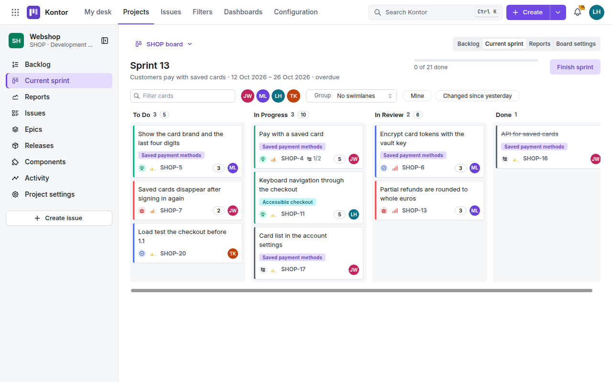
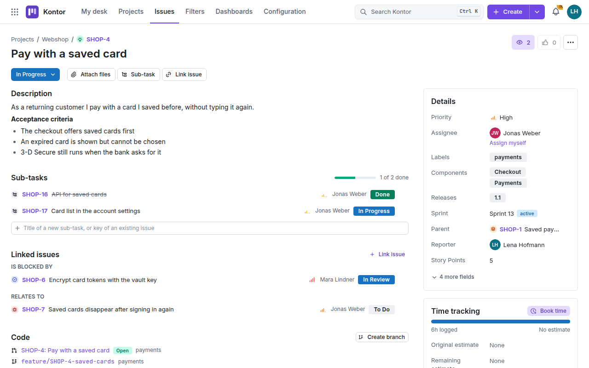
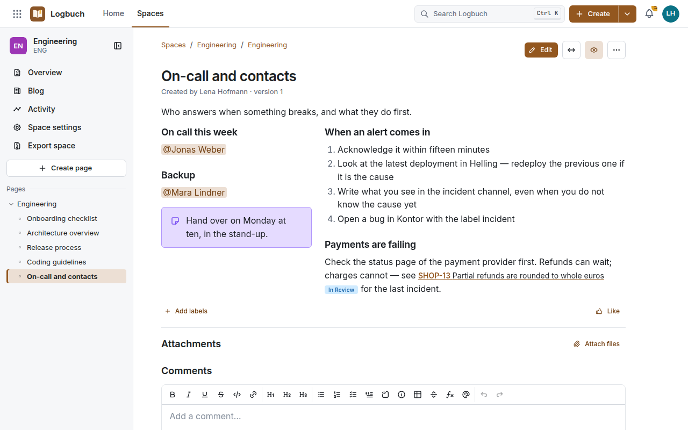
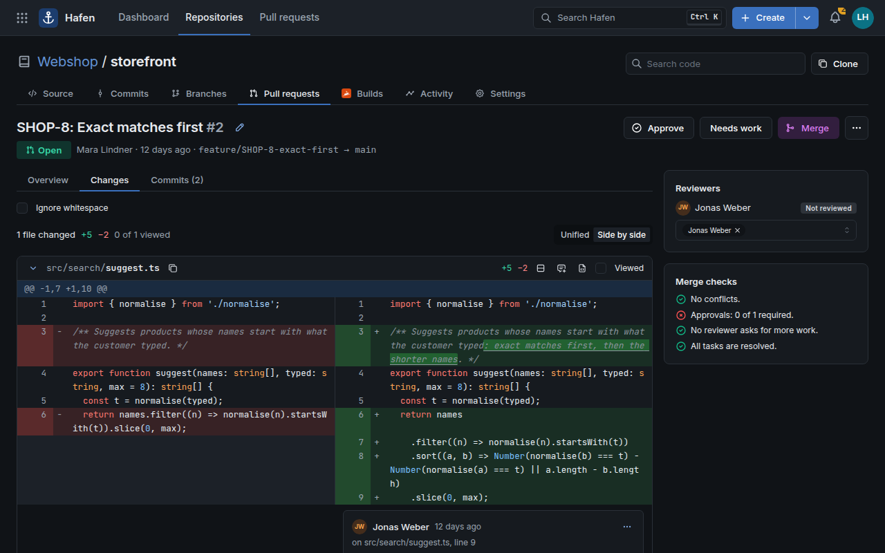
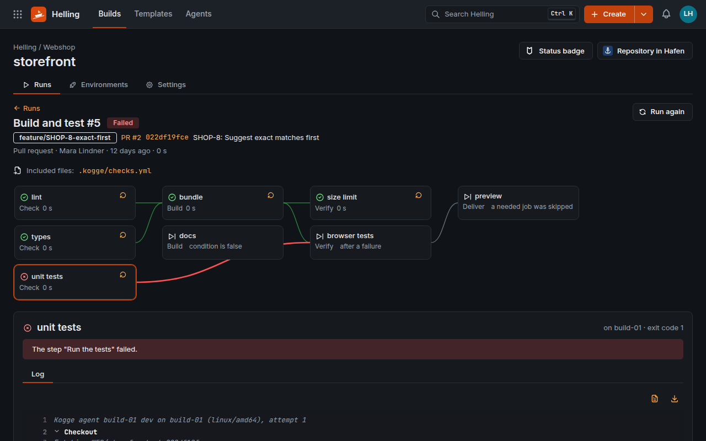

<div align="center">


# Kogge

**Vorgänge, Wiki, Code und Builds – auf Ihren eigenen Servern.**

[**Live-Vorschau ausprobieren →**](https://chillandimprove.github.io/Kogge/)

[](LICENSE)


[Produkte](#die-vier-produkte) · [Stand](#stand) · [Schnellstart](#schnellstart) · [Installation](#installation) ·
[Migration](#migration-aus-atlassian-data-center) · [Architektur](#architektur) · [Entwicklung](#entwicklung) ·
[**English**](README.md)

</div>

[](https://chillandimprove.github.io/Kogge/)

Kogge bringt zusammen, womit Software-Teams jeden Tag arbeiten: Vorgänge mit agilen Boards, ein Wiki, Git-Hosting
mit Pull-Requests und Pipelines, die bauen und ausliefern. Es ist ein einzelnes Go-Binary mit PostgreSQL dahinter,
läuft ohne Internetzugang und lässt jedes Byte bei Ihnen – eine selbst betriebene Alternative zu Jira, Confluence,
Bitbucket und Bamboo Data Center, mit den Werkzeugen für den Umzug von dort.

**Made in Bavaria** – entwickelt in Bayern, für Unternehmen und Behörden, die ihre Arbeit im eigenen Haus behalten.

- **Immer On-Premises.** Keine Cloud-Version, in die Sie gedrängt werden, keine Telemetrie, kein Lizenzserver, auch
  ganz ohne Internet. Freie Software unter der [EUPL-1.2](LICENSE), kostenlos für beliebig viele Benutzer.
- **Eine Plattform statt vier Werkzeugen.** Vorgangsschlüssel verknüpfen Commits, Branches, Pull-Requests, Builds
  und Deployments; Wiki-Seiten zeigen Vorgänge und Builds live; eine Schnellsuche (Strg+K, auf dem Mac ⌘K), ein
  Aktivitätsstrom, eine Anmeldung und ein Berechtigungsmodell für alles.
- **Schlank im Betrieb.** Ein Binary mit eingebauter Web-Anwendung, PostgreSQL als einziger Dienst mit Zustand,
  Docker Compose oder systemd. Rund 100 MB Arbeitsspeicher für 500 Personen und 200.000 Vorgänge
  ([gemessen](#ressourcen)).
- **Gemacht für Organisationen.** Single Sign-on über Keycloak (LDAP/AD, Kerberos, SAML), Zwei-Faktor-Anmeldung,
  ein Audit-Log, das Kogge selbst nicht ändern kann (mit SIEM-Anbindung), Sicherung im laufenden Betrieb,
  Kontingente, Prometheus-Metriken, DSGVO-Export und Anonymisierung, signierte Release-Images mit SBOM.
- **Der Weg aus Data Center.** Jira, Confluence, Bitbucket und Bamboo ziehen Produkt für Produkt um, mit einem
  Bericht vor dem Umzug und einer Prüfung danach.
- **Keine KI-Funktionen** – bewusst.

## Die vier Produkte

| Produkt | Was es ist | Statt |
|---|---|---|
| **Kontor** | Vorgänge und agile Boards: Projekte, Workflows mit Bedingungen und Prüfungen, eigene Felder, Scrum- und Kanban-Boards, Backlog, Sprints, Epics, Releases, Berichte (Burndown, Velocity, kumulatives Flussdiagramm), Dashboards, gespeicherte Filter mit E-Mail-Abonnements, CSV-Export, Sammeländerungen für bis zu 1.000 Vorgänge und KQL – eine Abfragesprache mit Verlaufsabfragen (`WAS`, `CHANGED`) und Autovervollständigung | Jira |
| **Logbuch** | Das Wiki: Bereiche, Seitenbäume, ein Editor mit Befehlsmenü („/“), Markdown beim Tippen oder als Quelltext neben einer Live-Vorschau, LaTeX-Formeln, gemeinsames Bearbeiten in Echtzeit, Layouts in Spalten, Versionen mit Vergleich, Kommentare, Vorlagen, Makros (Mermaid, Vorgangslisten), Einschränkungen; Export als HTML, Markdown oder PDF mit Inhaltsverzeichnis | Confluence |
| **Hafen** | Git-Hosting über HTTPS und SSH mit LFS: Pull-Requests mit Reviews, Vorschlägen, Aufgaben und Merge-Checks, Diffs nebeneinander mit markierten Wörtern, Merge-Commit, Squash, Fast-Forward und Rebase, Auto-Merge, Code-Owner, Branch-Berechtigungen, Codesuche, signierte Webhooks | Bitbucket |
| **Helling** | Builds und Deployments: Pipelines als Code mit Matrix-Builds, Zeitplänen, `needs`, `if` und `include`, Build-Agenten auf eigenen Servern (Shell oder Container mit Grenzen für CPU und Speicher), Artefakte, Caches, Testberichte (JUnit), Umgebungen und Deployments mit Freigaben | Bamboo |

<table>
  <tr>
    <td width="50%"><br>
      <sub><b>Kontor</b> – ein Vorgang mit Unteraufgaben, Verknüpfungen, Pull-Requests und Branches</sub></td>
    <td width="50%"><br>
      <sub><b>Logbuch</b> – eine Seite in zwei Spalten, mit Erwähnungen und einem Vorgang live</sub></td>
  </tr>
  <tr>
    <td width="50%"><br>
      <sub><b>Hafen</b> – ein Pull-Request nebeneinander, geänderte Wörter markiert</sub></td>
    <td width="50%"><br>
      <sub><b>Helling</b> – ein Lauf, dessen Jobs auf die Jobs warten, die sie brauchen</sub></td>
  </tr>
</table>

Die Oberfläche spricht Deutsch und Englisch und folgt dem hellen oder dunklen Farbschema des Systems. Die Namen
stammen aus der Seefahrt der Hanse: Die *Kogge* war ihr Schiff, das *Kontor* ihre Handelsniederlassung, das
*Logbuch* das Bordbuch, der *Hafen* ihr Ziel und die *Helling* die Werftrampe, auf der Schiffe gebaut werden.

## Stand

Kogge ist jung und wurde noch bei keinem Kunden produktiv betrieben.

**Was trägt – und wie wir das wissen:**

- Integrationstests gegen eine echte PostgreSQL und echtes Git für alle vier Produkte: Push über HTTPS und SSH,
  Pipelines auf einem echten Build-Agenten, Sicherung und Wiederherstellung.
- Ein Berechtigungstest über jede Route der API und eine Zeitgrenze für jede Route.
- Browsertests in Chrome, Firefox und WebKit (Safari), mit Prüfung der Barrierefreiheit (WCAG 2.1 AA).
- Aktualisierungen: Datenbanken älterer Versionen werden samt Daten migriert und geprüft, und Sicherungen älterer
  Versionen lassen sich in die aktuelle zurückspielen.
- Der Compose-Stack wird von Anfang bis Ende getestet – starten, anmelden, Vorgang anlegen, über HTTPS und SSH
  pushen, sichern, prüfen –, auch mit zwei Web-Knoten, zwei Workern und einem Load Balancer, wobei ein Web-Knoten
  ausfallen darf.
- Migration: Analyse, Laden und Prüfung gegen nachgebaute Jira-, Confluence-, Bitbucket- und Bamboo-Server, auch mit
  100.000 Vorgängen und 50.000 Seiten bei wenig Speicher.
- Eine Sicherheitsprüfung des ganzen Codes durch das Entwicklungsteam (keine unabhängige): Die gefundenen Lücken sind
  behoben, jede mit einem Test.
- Ein Lasttest in der Referenzgröße S erreicht alle Leistungsziele (siehe [Ressourcen](#ressourcen)).

**Was noch fehlt:**

| Bereich | Noch nicht da |
|---|---|
| Kontor | Roadmap/Zeitleiste, Prioritäten je Projekt, Editor für Feldlayouts |
| Logbuch | Mermaid-Diagramme und SVG-Bilder im PDF (dort als Quelltext bzw. Verweis), Formeln im HTML- und PDF-Export (dort als LaTeX-Quelltext), PDF-Schriften für Sprachen außerhalb Europas |
| Hafen | Forks, Merge-Queue, Paket- und Container-Registry, Spiegelung |
| Helling | Agenten für Windows und macOS sind gebaut, aber noch nie im Einsatz erprobt |
| Migration | Jira-Workflows (die Übergänge werden frei), Filter und Dashboards, Daten von Apps (Tempo, ScriptRunner, Xray …), Jira Service Management; erprobt gegen nachgebaute Server, noch nicht gegen eine echte Installation |
| Betrieb | ein erstes veröffentlichtes Release, Lasttests auf eigener Hardware und in Größe M, Hochverfügbarkeit über mehrere Hosts, eine unabhängige Sicherheitsprüfung |

**Unsere Einschätzung:** bereit für den ersten produktiven Einsatz mit Begleitung – mit regelmäßiger Sicherung und,
wenn Sie umziehen, einem Probelauf der Migration mit Ihren Daten. Wer ab dem ersten Tag Hochverfügbarkeit über
mehrere Rechenzentren oder ein externes Sicherheitsgutachten braucht, sollte darauf noch warten.

## Schnellstart

Auf einem Entwicklungsrechner mit Go, Node.js und Docker oder Podman:

```sh
make dev-db     # PostgreSQL 18 in einem Container auf 127.0.0.1:55432
make run        # Kogge auf http://localhost:8080 – Anmeldung als admin / Kogge-Dev-Secret-2026
make web-dev    # die Web-Anwendung mit Hot Reload auf http://localhost:5173
```

Keycloak brauchen Sie dafür nicht: Kogge hat lokale Konten, und Single Sign-on ist erst eingeschaltet, wenn
`KOGGE_OIDC_ISSUER` gesetzt ist.

**Nur mal ansehen?** Die [Live-Vorschau](https://chillandimprove.github.io/Kogge/) läuft ganz im Browser, mit den
Beispielinhalten eines erfundenen Webshops. Zum Selbstbauen `make web-install showcase` ausführen und
`web/dist-showcase` mit einem beliebigen statischen Webserver ausliefern, z. B.
`python3 -m http.server -d web/dist-showcase 8000`.

## Installation

Kogge läuft als **Docker-Compose-Stack** (Kogge, PostgreSQL und Keycloak für Single Sign-on) oder als **einzelnes
Binary** mit systemd und einer vorhandenen PostgreSQL ab Version 16. Beides funktioniert ohne Internetzugang.

### Mit Docker Compose (empfohlen)

Voraussetzungen: ein Linux-Server (amd64 oder arm64) mit Docker Engine und Compose v2 sowie DNS-Namen mit
TLS-Zertifikaten für Kogge und die Anmeldung (z. B. `kogge.example.com` und `sso.example.com`).

```sh
docker build -f deploy/Dockerfile -t kogge .   # oder ein signiertes Release-Image verwenden
cd deploy
scripts/init-secrets.sh                         # Passwörter, Datenbank-URLs, OIDC-Secrets und der Master-Schlüssel
cp .env.example .env                            # mindestens KOGGE_PUBLIC_URL, KOGGE_SSO_URL und der Bootstrap-Admin
docker compose up -d                            # richtet die Datenbank ein, dann startet Kogge
```

- **Master-Schlüssel sichern**: Kopieren Sie `deploy/secrets/master_key` an einen sicheren Ort außerhalb des
  Servers. Ohne ihn lassen sich die in Kogge gespeicherten Geheimnisse nicht entschlüsseln, und Backups enthalten
  ihn nicht.
- **TLS und Reverse-Proxy**: Kogge (8080) und Keycloak (8081) lauschen auf 127.0.0.1, für einen Reverse-Proxy
  davor; Beispiele für nginx und Caddy liegen in `deploy/proxy/`. Alternativ beendet Kogge TLS selbst
  (`KOGGE_TLS_CERT_FILE`, `KOGGE_TLS_KEY_FILE`). Git über SSH läuft auf Port 2222.
- **Reverse-Proxy und Client-Adressen**: Der Compose-Stack vertraut dem `X-Forwarded-For` eines Proxys auf demselben
  Host. Läuft der Proxy auf einem anderen Host, setzen Sie `KOGGE_TRUSTED_PROXIES` auf dessen Adresse; kollidiert
  `172.31.252.0/24` mit einem vorhandenen Netz, wählen Sie mit `KOGGE_SUBNET` und `KOGGE_GATEWAY` ein anderes.
  Stimmt die Einstellung nicht, sieht Kogge alle Anfragen von einer Adresse – mit falschen IPs im Audit-Log.
- **Zum Ausprobieren ohne Proxy**: In `.env` `KOGGE_HTTP_PUBLISH=8080` und `KOGGE_SSO_PUBLISH=8081` setzen, die
  beiden URLs auf `http://<server>:8080` bzw. `http://<server>:8081` und `KOGGE_TRUSTED_PROXIES=` (leer).
- **Erste Anmeldung** als Bootstrap-Administrator (danach das Passwort aus `.env` entfernen).
  `KOGGE_DEFAULT_LOCALE` (`de` oder `en`) bestimmt beim allerersten Start die Sprache der Benutzer und der
  Grundkonfiguration (Rollen, Vorgangstypen, Status, Workflows, Seitenvorlagen). Die Keycloak-Konsole erreichen Sie
  über einen SSH-Tunnel unter `http://127.0.0.1:8081/admin/` (Passwort in `secrets/keycloak_admin_password`).
- **Benutzer und Active Directory/LDAP**: Legen Sie Benutzer in Keycloak an oder binden Sie Ihr Verzeichnis an
  (*User federation → Add LDAP provider*, Modus `READ_ONLY`, dazu ein `group-ldap-mapper` für die Gruppen). Kogge
  übernimmt Benutzer und Gruppen alle 15 Minuten; Berechtigungen vergeben Sie in Kogge an Gruppen.
- **Docker als Snap** (Ubuntu) kann keine Container mit `no-new-privileges` starten: Setzen Sie dort
  `KOGGE_NO_NEW_PRIVILEGES=false` in `.env`.
- **Ausprobieren**: `make smoke-test` startet den ganzen Stack unter eigenem Namen und eigenen Ports, probiert ihn
  von Anfang bis Ende aus und räumt danach auf; `make smoke-test-ha` tut dasselbe mit mehreren Knoten.

<details>
<summary><b>Mehrere Knoten</b></summary>

Mehrere Knoten hinter einem Load Balancer teilen die PostgreSQL-Datenbank, das Datenverzeichnis (`KOGGE_DATA_DIR`:
Repositories, Anhänge, LFS-Objekte, Artefakte, Build-Logs, SSH-Host-Schlüssel), den Master-Schlüssel und die
Konfiguration; jeder Knoten behält nur sein temporäres Verzeichnis (`TMPDIR`) für sich. `deploy/compose.ha.yaml`
zeigt das auf einem Docker-Host mit zwei Web-Knoten, zwei Workern, Caddy für HTTP und nginx für SSH
(`docker compose -f compose.yaml -f compose.ha.yaml up -d`).

- **Load Balancer**: Anfragen nur an Knoten, deren `/readyz` antwortet; nichts puffern (Git, Uploads); WebSockets und
  Event-Streams durchlassen und lange Verbindungen offen halten; Sticky Sessions sind nicht nötig. SSH braucht einen
  TCP-Load-Balancer; alle Knoten zeigen denselben Host-Schlüssel.
- **Über mehrere Hosts**: das Datenverzeichnis auf einem geteilten Dateisystem, z. B. NFS 4.1 oder neuer mit `hard`,
  Close-to-open-Konsistenz und `lookupcache=positive`. PostgreSQL braucht eigene Hochverfügbarkeit (z. B. Patroni)
  und gehört nicht auf NFS.
- **Worker und Verbindungen**: weitere Knoten mit `KOGGE_ROLES=worker`; periodische Aufgaben laufen auf dem gewählten
  Leader. Jeder Knoten öffnet bis zu 25 Datenbankverbindungen (`pool_max_conns` in `KOGGE_DATABASE_URL`) und bis zu
  16 weitere, solange Git-Schreibzugriffe auf eine Sicherung warten – bemessen Sie `max_connections` entsprechend.

</details>

<details>
<summary><b>Build-Agenten für Helling</b></summary>

Pipelines laufen auf Build-Agenten, die sich bei Kogge melden und Aufträge abholen – Build-Server brauchen weder
eingehende Ports noch Internet. Kogge bietet `kogge-agent` unter *Helling → Agents* zum Download an:

```sh
curl -fLo kogge-agent https://kogge.example.com/downloads/kogge-agent-linux-amd64 && chmod +x kogge-agent
./kogge-agent register -server https://kogge.example.com -token kgr_… -name build-01 -container docker
./kogge-agent run
```

Danach geben Sie den Agenten in Helling frei. Mit `-container docker` (oder `podman`) läuft jeder Job in einem
eigenen Container; `-shell` führt Jobs direkt als Benutzer des Agenten aus – nur für Repositories, deren Autoren Sie
vertrauen. `-max-cpus` und `-max-memory` schützen den Build-Server: Jobs, deren Container mehr verlangen, gehen an
andere Agenten. Ein Image des Agenten baut `docker build -f deploy/Dockerfile --target agent -t kogge-agent .`.

</details>

<details>
<summary><b>Ohne Docker: ein Binary mit systemd</b></summary>

1. PostgreSQL-Rolle und -Datenbank anlegen (`createuser -P kogge && createdb -O kogge kogge`), dann als Superuser die
   Rolle einrichten, mit der Kogge läuft und die das Audit-Log nicht ändern kann:
   `sudo -u postgres env KOGGE_DATABASE_URL='postgres:///kogge?host=/var/run/postgresql' kogge admin init-database -owner kogge -app-password-file /etc/kogge/db-app-password`.
2. Das Binary als `/usr/local/bin/kogge` installieren (`make build` erzeugt es in `bin/`), den Benutzer `kogge` und
   das Datenverzeichnis `/var/lib/kogge` anlegen.
3. Master-Schlüssel erzeugen: `kogge admin gen-master-key > /etc/kogge/master.key` (nur für `kogge` lesbar).
4. `/etc/kogge/kogge.env` mit den Einstellungen schreiben (`KOGGE_DATABASE_URL` mit der Rolle `kogge_app`) und
   `/etc/kogge/kogge-owner.env` mit der `KOGGE_DATABASE_URL` des Eigentümers (nur für root lesbar). Dann
   `kogge.service`, `kogge-migrate.service`, `kogge-backup.*` und `kogge-audit-retention.*` aus `deploy/systemd/`
   installieren und `systemctl enable --now kogge kogge-backup.timer kogge-audit-retention.timer`. Vor jedem Start
   migriert `kogge-migrate.service` als Eigentümer; Kogge sichert jede Nacht, und der zweite Timer wendet wöchentlich
   die Aufbewahrungsfrist des Audit-Logs an.

</details>

<details>
<summary><b>Ohne Internetzugang</b></summary>

`make bundle` packt die Images, die Binaries, die Deployment-Dateien (auch für mehrere Knoten und die Überwachung)
und die SBOMs (CycloneDX) mit Prüfsummen in `dist/kogge-VERSION-linux-ARCH.tar`. Auf dem Zielserver prüft
`install.sh` das Archiv, lehnt eines für eine andere Architektur ab und lädt die Images; danach geht es mit Schritt 2
der Compose-Installation weiter.

</details>

<details>
<summary><b>Releases prüfen</b></summary>

Ein Tag `v1.2.0` startet den Release-Workflow: alle Tests, dann signierte Images für amd64 und arm64 in `ghcr.io` mit
SBOM und SLSA-Provenienz und ein GitHub-Release mit Binaries, SBOM, Offline-Archiven und signierter `SHA256SUMS`.
`make release-local VERSION=1.2.0` baut dasselbe lokal, ohne zu signieren oder zu veröffentlichen. Prüfen Sie ein
Release mit [cosign](https://github.com/sigstore/cosign) ab v3 (`OWNER/REPO` ist dieses Repository):

```sh
ID=https://github.com/OWNER/REPO/.github/workflows/release.yml@refs/tags/v1.2.0
ISSUER=https://token.actions.githubusercontent.com
cosign verify ghcr.io/OWNER/kogge:1.2.0 --certificate-identity "$ID" --certificate-oidc-issuer "$ISSUER"
cosign verify-attestation --type cyclonedx ghcr.io/OWNER/kogge:1.2.0 --certificate-identity "$ID" \
  --certificate-oidc-issuer "$ISSUER" | jq -r .payload | base64 -d | jq .predicate > kogge.cdx.json
cosign verify-blob SHA256SUMS --bundle SHA256SUMS.sigstore.json --certificate-identity "$ID" --certificate-oidc-issuer "$ISSUER"
sha256sum -c SHA256SUMS --ignore-missing
```

</details>

### Wichtige Einstellungen

| Variable | Bedeutung |
|---|---|
| `KOGGE_PUBLIC_URL` | Die Adresse, unter der Kogge erreichbar ist, z. B. `https://kogge.example.com` |
| `KOGGE_DATABASE_URL` | PostgreSQL ab 16, z. B. `postgres://kogge_app:…@db:5432/kogge`; `pool_max_conns` setzt die Verbindungen je Knoten (Standard 25) |
| `KOGGE_DATA_DIR` | Repositories, Anhänge, LFS-Objekte, Artefakte und Build-Logs |
| `KOGGE_MASTER_KEY_FILE` | Der Master-Schlüssel für gespeicherte Geheimnisse |
| `KOGGE_TRUSTED_PROXIES` | Adressen der Reverse-Proxys, deren `X-Forwarded-For` gilt |
| `KOGGE_ROLES` | `web`, `worker` oder beides (Standard) |
| `KOGGE_DEFAULT_LOCALE` | Sprache einer neuen Installation, `de` (Standard) oder `en`; gilt nur beim allerersten Start |
| `KOGGE_REQUEST_TIMEOUT`, `KOGGE_STALL_TIMEOUT` | Zeitgrenzen gewöhnlicher Anfragen und von Übertragungen ohne Fortschritt (je `1m`) |
| `KOGGE_OIDC_ISSUER`, `KOGGE_OIDC_CLIENT_ID`, `KOGGE_OIDC_CLIENT_SECRET` | Single Sign-on (im Compose-Stack vorbereitet) |
| `KOGGE_SMTP_HOST`, `KOGGE_SMTP_PORT`, `KOGGE_SMTP_FROM` | E-Mail für Benachrichtigungen und Filter-Abonnements |
| `KOGGE_AUDIT_FORWARD_URL` | Audit-Ereignisse an ein SIEM, z. B. `syslog+tls://siem.example.com:6514` |
| `KOGGE_METRICS_ADDR` | Prometheus-Metriken auf eigenem Port |

Grenzen, Kontingente und den freien Speicher, den Kogge auf dem Datenträger des Datenverzeichnisses lässt
(Standard: das Größere von 2 GiB und 2 %), legen Sie unter *Administration → Einstellungen → Grenzen* fest.
`deploy/monitoring/` enthält Alarmregeln für Prometheus, ein Grafana-Dashboard und eine Beispielkonfiguration;
`make monitoring-check` prüft die Regeln.

### Sicherung, Wiederherstellung und Aktualisierung

```sh
docker compose exec kogge kogge admin backup -dir /backups -keep 7        # im laufenden Betrieb; Git pausiert kurz
docker compose run --rm migrate admin restore /backups/kogge-backup-….tar  # in eine leere Installation
docker build -f deploy/Dockerfile -t kogge . && docker compose up -d       # Aktualisierung; die Datenbank migriert mit
```

Eine Wiederherstellung braucht denselben Master-Schlüssel. Keycloak hält seine Benutzer in einer eigenen Datenbank
(`keycloak-db`); sichern Sie sie mit `pg_dump`. `kogge admin fsck` prüft das Datenverzeichnis gegen die Datenbank.

## Ressourcen

Gemessen am 31. Oktober 2026 mit `make scale-generate SCALE_SIZE=S` und `make scale-bench`: 500 Personen,
200.000 Vorgänge in 100 Projekten, 20.000 Seiten, 300 Repositories (eine Datenbank von 1,6 GB), der Benchmark mit
4 parallelen Anfragen ohne Pause, auf einem i9-12900K mit NVMe.

| Kogge | PostgreSQL | Ziele erreicht (p95) | Kogge-Speicher, Spitze | PostgreSQL-Speicher, Spitze |
|---|---|---|---|---|
| ohne Grenzen | ohne Grenzen | 13 von 13 | 100 MB | 267 MB (956 MB mit Datei-Cache) |
| 4 CPU-Threads, 512 MB | 4 CPU-Threads, 1 GB | 13 von 13 | 137 MB | 258 MB (819 MB mit Datei-Cache) |
| 2 CPUs, 512 MB | 2 CPUs, 1 GB | 10 von 13 – Volltextsuchen zu langsam | 127 MB | 282 MB |

Zum Beispiel (95. Perzentil, Ziel in Klammern, gemessen auf einem geteilten Entwicklungsrechner): Vorgangsansicht
5 ms (150 ms), KQL-Suche 68 ms (300 ms), Board mit 300 Karten 13 ms (500 ms), Schnellsuche 88 ms (200 ms),
Pull-Request-Diff mit 2.000 Zeilen 328 ms (800 ms), Push von 100 Commits bis sichtbar im Vorgang 315 ms (5 s),
Übergabe eines Jobs an einen Agenten 20 ms (2 s).

Im Leerlauf braucht Kogge etwa 90 MB und PostgreSQL etwa 175 MB, beide fast ohne CPU. In dieser Größe begrenzt nicht
der Speicher, sondern die CPU von PostgreSQL, denn dort läuft die Volltextsuche. Planen Sie Reserve für das ein, was
der Benchmark nicht abdeckt: Git läuft als Kindprozess von Kogge, sein Speicher zum Packen wächst mit den
Repositories, und der Cache von PostgreSQL will mit den Daten wachsen. Keycloak braucht etwa 1 GB zusätzlich. Je
4 vCPUs und 8 GB für Kogge und PostgreSQL sind für Größe S ein großzügiger Start.

## Migration aus Atlassian Data Center

Jira, Confluence, Bitbucket und Bamboo Data Center ziehen je Produkt in vier Schritten um, die Sie einzeln oder mit
`all` zusammen ausführen:

```sh
kogge import jira extract  …   # über die REST-API in ein Arbeitsverzeichnis lesen; setzt nach Abbruch fort
kogge import jira analyse  …   # druckbarer Bericht: was migriert wird, wie, was nicht genau geht, was zu entscheiden ist
kogge import jira load     …   # in Kogge laden; wiederholbar, Fehler einzelner Einträge halten das Laden nicht an
kogge import jira validate …   # Prüfbericht: Anzahlen, Prüfsummen der Anhänge, Links, Stichproben; Status 1 bei Fehlern
```

`kogge import` ohne Argumente zeigt alle Schritte und Optionen. Die Quellsysteme brauchen persönliche Zugriffstokens
(Jira ab 8.14, Confluence ab 7.9). Alte Adressen – `/browse/KEY-1`, Confluence-Seiten, Bitbucket-Repositories und
Bamboo-Pläne – führen nach dem Umzug zu Kogge. Planen Sie einen Probelauf mit Ihren Daten: Sein Bericht zeigt, was
Ihre Installation an Besonderheiten hat und wie lange das Laden dauert.

## Architektur

- **Ein modularer Monolith in Go.** Anfragen gehen von HTTP-Handlern ([huma](https://huma.rocks), OpenAPI aus dem
  Code) über Services (Berechtigungen, Transaktionen, Ereignisse) zu Stores mit explizitem SQL
  ([pgx](https://github.com/jackc/pgx)). Die vier Produkte importieren einander nie; was sie verbindet, liegt in
  `internal/links`. Jeder Knoten übernimmt die Rolle Web, Worker oder beide.
- **PostgreSQL für alles mit Zustand** – Daten, Volltextsuche, die Auftragswarteschlange
  ([River](https://riverqueue.com)) und die Nachrichten zwischen den Knoten. Repositories, Anhänge und Artefakte
  liegen im Datenverzeichnis; Git läuft als `git`-Kommandozeile.
- **Ein Dokumentmodell** für Vorgänge, Seiten und Kommentare, gemeinsam bearbeitet über Schritte, die der Server
  anwendet; Markdown wird hinein- und herausgewandelt, und die Importer wandeln die Formate der migrierten Produkte.
- **Eine React-Anwendung** ([Mantine](https://mantine.dev), [Tiptap](https://tiptap.dev)), ins Binary eingebettet;
  `go run ./cmd/kogge openapi` gibt die API aus, die sie nutzt – ohne Datenbank.

```
cmd/
  kogge/            der Server mit den Befehlen admin, import und migrate
  kogge-agent/      der Build-Agent
internal/
  issues/ wiki/ code/ builds/   die vier Produkte (sie importieren einander nie)
  links/            was sie verbindet: Vorgangsschlüssel in Commits, Builds und Seiten
  identity/ authz/ account/ admin/   Benutzer, Anmeldung, Sitzungen, Berechtigungen
  importer/         Migrationen aus Jira, Confluence, Bitbucket und Bamboo
  platform/         Datenbank, HTTP-API, Fehler, Ereignisse, Speicher
  migrations/       SQL-Migrationen (nur vorwärts)
  backup/ notify/ webhooks/ privacy/ docmodel/ agent/ app/ config/ webui/ …
web/                die React-Web-Anwendung (beim Build ins Binary eingebettet)
e2e/                Browsertests (Playwright) und die aufgezeichnete Vorschau
deploy/             Dockerfile, Compose-Stacks, Keycloak-Realm, Proxys, systemd-Units, Überwachung, Skripte
tools/              CI, Lizenzprüfung, SBOM, Release-Notes, Datengenerator und Benchmark für die Lasttests
```

## Entwicklung

Voraussetzungen: Go 1.27.3 oder neuer, Node.js 22 oder neuer, Docker oder Podman (für PostgreSQL), Git 2.39.1 oder
neuer.

```sh
make test             # Go- und Web-Tests (die Go-Tests starten PostgreSQL in einem Container)
make lint             # Formatierung und statische Prüfungen
make api-types        # die API-Typen der Web-Anwendung nach Änderungen an der API neu erzeugen
make e2e              # Browsertests gegen ein laufendes Kogge (KOGGE_E2E_URL, KOGGE_E2E_BROWSER)
make ci-local         # die ganze CI-Pipeline für HEAD in einem sauberen Checkout, mit Images und Browsertests
make build            # Release-Binaries mit eingebetteter Web-Anwendung nach bin/
make help             # alle Ziele
```

`make hooks` schaltet die Git-Hooks ein, die einen Commit vorher prüfen und danach die CI-Pipeline lokal laufen
lassen. Commits folgen [Conventional Commits](https://www.conventionalcommits.org) (`feat(issues): …`),
Quelldateien tragen einen SPDX-Header ([REUSE](https://reuse.software)), und neue Abhängigkeiten stehen unter einer
freizügigen Lizenz, der MPL-2.0 oder der LGPL.

Issues und Pull-Requests sind willkommen. Kogge ist jung: Wenn Ihnen etwas fehlt, eröffnen Sie ein Issue und
schreiben Sie, wofür Sie es brauchen. Wenn Sie die Weiterentwicklung finanziell unterstützen möchten, sagen Sie es
dort – Wünsche von Unterstützern haben Vorrang.

## Sicherheitslücken melden

Bitte melden Sie Sicherheitslücken nicht in einem öffentlichen Issue, sondern vertraulich über GitHubs private
Meldung (*Security → Report a vulnerability*) oder direkt an die Maintainer.

## Lizenz

Kogge ist freie Software unter der [European Union Public Licence v1.2](LICENSE) (EUPL-1.2). Die Lizenzen der
verwendeten Fremdkomponenten schreibt der Build in `THIRD_PARTY_LICENSES.md`, die Stückliste (SBOM) in
`sbom.cdx.json`; beide liegen jedem Image bei.

Die Nutzung kostet nichts, für beliebig viele Benutzer. Die Lizenz gilt für den Code, nicht für den Namen: Sie
gewährt keine Rechte am Namen Kogge oder an seinem Logo als Kennzeichen (EUPL, Artikel 5). Bitte geben Sie
veränderten Fassungen, die Sie verbreiten, einen eigenen Namen.

Jira, Confluence, Bitbucket, Bamboo und Crowd sind Marken ihres jeweiligen Inhabers. Kogge ist ein unabhängiges
Produkt und weder mit ihm verbunden noch von ihm unterstützt oder abgeleitet.
