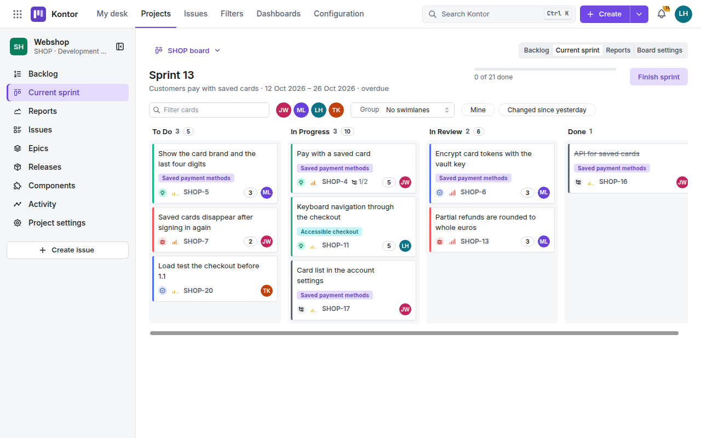
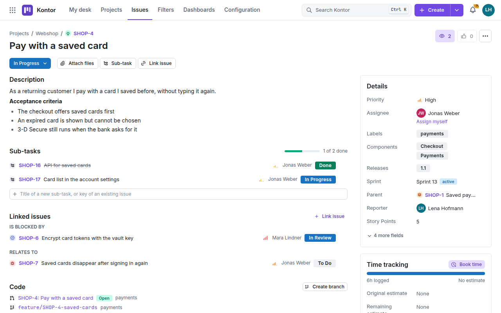
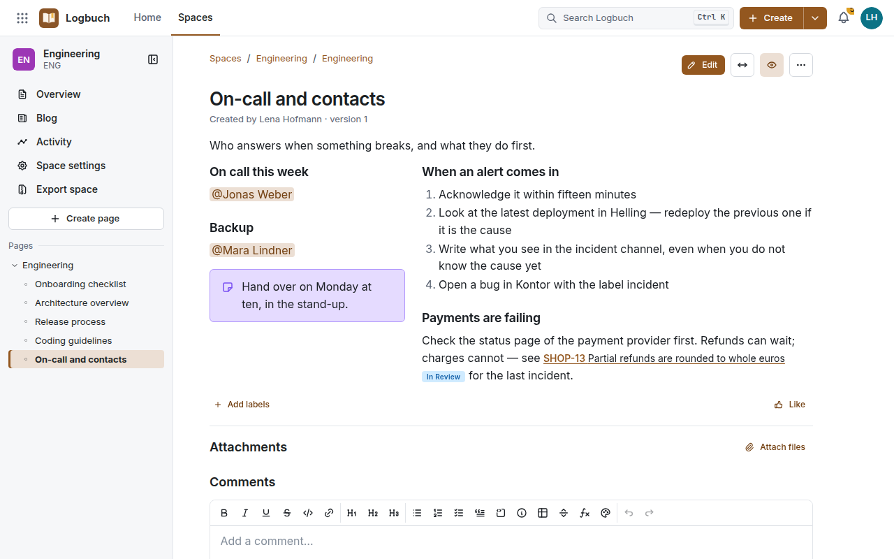
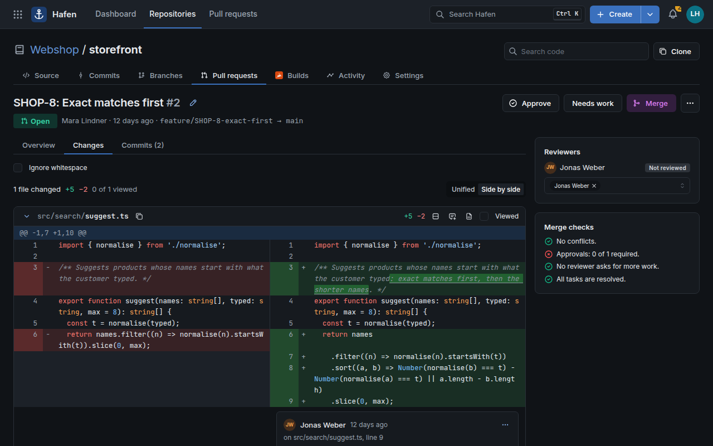
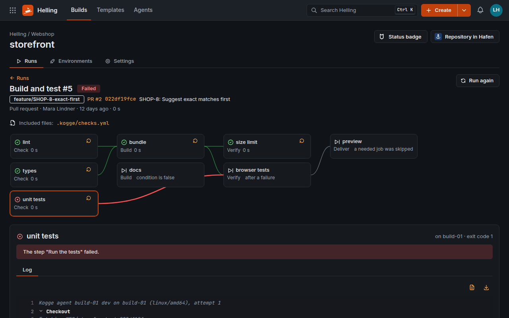

<div align="center">


# Kogge

**Issues, wiki, code and builds – on your own servers.**

[**Try the live preview →**](https://chillandimprove.github.io/Kogge/)

[](LICENSE)


[Products](#the-four-products) · [Status](#status) · [Quick start](#quick-start) · [Installation](#installation) ·
[Migration](#migration-from-atlassian-data-center) · [Architecture](#architecture) · [Development](#development) ·
[**Deutsch**](README.de.md)

</div>

[](https://chillandimprove.github.io/Kogge/)

Kogge puts what software teams use every day on one platform: an issue tracker with agile boards, a wiki, Git
hosting with pull requests, and pipelines that build and deploy. It is a single Go binary with PostgreSQL behind
it, runs without internet access and keeps every byte with you – a self-hosted alternative to Jira, Confluence,
Bitbucket and Bamboo Data Center, with the tools to move over from them.

**Made in Bavaria** – for companies and public authorities that keep their work in house.

- **On-premises, for good.** No cloud edition you will be pushed to, no telemetry, no licence server, and it works
  air-gapped. Free software under the [EUPL-1.2](LICENSE), free of charge for any number of users.
- **One platform instead of four tools.** Issue keys link commits, branches, pull requests, builds and deployments;
  wiki pages show live issues and builds; one quick search (Ctrl+K, ⌘K on a Mac), one activity stream, one sign-in
  and one permission model across everything.
- **Light to run.** One binary with the web application inside, PostgreSQL as the only stateful service, Docker
  Compose or systemd. About 100 MB of memory for 500 people and 200,000 issues ([measured](#resources)).
- **Made for organisations.** Single sign-on through Keycloak (LDAP/AD, Kerberos, SAML), two-factor sign-in, an audit
  log Kogge itself cannot alter (with SIEM forwarding), online backups, quotas, Prometheus metrics, GDPR export and
  anonymisation, signed release images with an SBOM.
- **A way out of Data Center.** Jira, Confluence, Bitbucket and Bamboo move over product by product, with a report
  before the move and a check after it.
- **No AI features** – on purpose.

## The four products

| Product | What it is | Instead of |
|---|---|---|
| **Kontor** | Issues and agile boards: projects, workflows with conditions and validators, custom fields, Scrum and Kanban boards, backlog, sprints, epics, releases, reports (burndown, velocity, cumulative flow), dashboards, saved filters with e-mail subscriptions, CSV export, bulk changes for up to 1,000 issues, and KQL – a query language with history queries (`WAS`, `CHANGED`) and completion | Jira |
| **Logbuch** | The wiki: spaces, page trees, an editor with a command menu (`/`), Markdown while typing or as source beside a live preview, LaTeX formulas, live co-editing, layouts in columns, versions with comparison, comments, templates, macros (Mermaid, issue lists), restrictions; export as HTML, Markdown or PDF with a table of contents | Confluence |
| **Hafen** | Git hosting over HTTPS and SSH with LFS: pull requests with reviews, suggestions, tasks and merge checks, word-level diffs side by side, merge commit, squash, fast-forward and rebase, auto-merge, code owners, branch permissions, code search, signed webhooks | Bitbucket |
| **Helling** | Builds and deployments: pipelines as code with matrices, schedules, `needs`, `if` and `include`, build agents on your own servers (shell or containers with CPU and memory limits), artefacts, caches, JUnit reports, environments and deployments with approvals | Bamboo |

<table>
  <tr>
    <td width="50%"><br>
      <sub><b>Kontor</b> – an issue with its sub-tasks, links, pull requests and branches</sub></td>
    <td width="50%"><br>
      <sub><b>Logbuch</b> – a page in two columns, with mentions and a live issue</sub></td>
  </tr>
  <tr>
    <td width="50%"><br>
      <sub><b>Hafen</b> – a pull request side by side, changed words marked</sub></td>
    <td width="50%"><br>
      <sub><b>Helling</b> – a run whose jobs wait for the jobs they need</sub></td>
  </tr>
</table>

The interface speaks German and English and follows the light or dark scheme of the system. The names come from the
seafaring of the Hanseatic League: the *Kogge* (cog) was its ship, the *Kontor* its trading post, the *Logbuch* the
ship's log, the *Hafen* its harbour and the *Helling* the slipway on which ships are built.

## Status

Kogge is young and has not run in production at a customer yet.

**What holds, and how we know:**

- Integration tests against a real PostgreSQL and real Git for all four products: pushes over HTTPS and SSH,
  pipelines on a real build agent, backup and restore.
- A permission test over every route of the API, and a time limit for every route.
- Browser tests in Chrome, Firefox and WebKit, with accessibility checks (WCAG 2.1 AA).
- Upgrades: databases of older versions are migrated with their data and checked, and backups of older versions
  restore into the current one.
- The Compose stack is tested end to end – start, sign in, create an issue, push over HTTPS and SSH, back up, check –
  also with two web nodes, two workers and a load balancer, one web node failing on the way.
- Migrations tested against mock Jira, Confluence, Bitbucket and Bamboo servers, also with 100,000 issues and 50,000
  pages in little memory.
- A security review of the whole code by the development team (not an independent one); every hole it found is
  fixed and has a test.
- A load test at reference size S that meets every performance target (see [Resources](#resources)).

**Still missing:**

| Area | Not there yet |
|---|---|
| Kontor | Roadmap/timeline, priorities per project, an editor for field layouts |
| Logbuch | Mermaid diagrams and SVG images in PDF exports, formulas in HTML and PDF exports (shown as LaTeX source), PDF fonts for scripts outside Europe |
| Hafen | Forks, merge queue, package and container registry, mirroring |
| Helling | Windows and macOS agents are built but untried in real use |
| Migration | Jira workflows (transitions become free), filters and dashboards, data of apps (Tempo, ScriptRunner, Xray …), Jira Service Management; not yet tried against a real installation |
| Operations | A first published release, load tests on dedicated hardware and at size M, high availability across hosts, an independent security audit |

**Our assessment:** ready for a first production use with support – with regular backups and, if you move over, a
trial migration with your data. If you need high availability across data centres or an external security audit
from day one, wait a little longer.

## Quick start

On a development machine with Go, Node.js and Docker or Podman:

```sh
make dev-db     # PostgreSQL 18 in a container on 127.0.0.1:55432
make run        # Kogge on http://localhost:8080 – sign in as admin / Kogge-Dev-Secret-2026
make web-dev    # the web application with hot reload on http://localhost:5173
```

No Keycloak is needed for this: Kogge has local accounts, and single sign-on is switched on only when
`KOGGE_OIDC_ISSUER` is set.

**Just looking?** The [live preview](https://chillandimprove.github.io/Kogge/) runs entirely in the browser, with the
sample content of a fictitious web shop. To build it yourself, run `make web-install showcase` and serve
`web/dist-showcase` with any static web server, e.g. `python3 -m http.server -d web/dist-showcase 8000`.

## Installation

Kogge runs as a **Docker Compose stack** (Kogge, PostgreSQL and Keycloak for single sign-on) or as a **single
binary** with systemd and an existing PostgreSQL 16 or newer. Both work without internet access.

### Docker Compose (recommended)

Requirements: a Linux server (amd64 or arm64) with Docker Engine and Compose v2, and DNS names with TLS certificates
for Kogge and the sign-in (for example `kogge.example.com` and `sso.example.com`).

```sh
docker build -f deploy/Dockerfile -t kogge .   # or use a signed release image
cd deploy
scripts/init-secrets.sh                         # passwords, database URLs, OIDC secrets and the master key
cp .env.example .env                            # at least KOGGE_PUBLIC_URL, KOGGE_SSO_URL and the bootstrap admin
docker compose up -d                            # sets up the database, then starts Kogge
```

- **Keep the master key** (`deploy/secrets/master_key`) somewhere safe outside the server: without it the secrets
  stored in Kogge cannot be decrypted, and backups do not contain it.
- **TLS and reverse proxy:** Kogge (8080) and Keycloak (8081) listen on 127.0.0.1 for a reverse proxy; examples for
  nginx and Caddy are in `deploy/proxy/`. Kogge can also terminate TLS itself (`KOGGE_TLS_CERT_FILE`,
  `KOGGE_TLS_KEY_FILE`). Git over SSH uses port 2222. A proxy on another host goes into `KOGGE_TRUSTED_PROXIES`.
- **Trying it without a proxy:** set `KOGGE_HTTP_PUBLISH=8080`, `KOGGE_SSO_PUBLISH=8081`, the two URLs to
  `http://<server>:8080` and `http://<server>:8081`, and `KOGGE_TRUSTED_PROXIES=` (empty) in `.env`.
- **First sign-in** as the bootstrap administrator (then remove its password from `.env`). `KOGGE_DEFAULT_LOCALE`
  (`de` or `en`) sets the language of users and of the initial configuration on the very first start.
- **Users and Active Directory/LDAP:** create users in Keycloak or federate your directory there; Kogge takes over
  users and groups every 15 minutes, and permissions are granted to groups in Kogge.
- **Docker as a snap** (Ubuntu) cannot start containers with `no-new-privileges`: set `KOGGE_NO_NEW_PRIVILEGES=false`.
- **Smoke test:** `make smoke-test` starts the whole stack under its own name and ports, tries it out end to end and
  cleans up; `make smoke-test-ha` does the same with several nodes.

<details>
<summary><b>Several nodes</b></summary>

Several nodes behind a load balancer share the PostgreSQL database, the data directory (`KOGGE_DATA_DIR`:
repositories, attachments, LFS objects, artefacts, build logs, SSH host keys), the master key and the configuration;
each node keeps only its temporary directory (`TMPDIR`) to itself. `deploy/compose.ha.yaml` shows this on one Docker
host with two web nodes, two workers, Caddy for HTTP and nginx for SSH
(`docker compose -f compose.yaml -f compose.ha.yaml up -d`).

- **Load balancer:** send requests only to nodes whose `/readyz` answers; buffer nothing (Git, uploads); let
  WebSockets and event streams through and keep long connections open; sticky sessions are not needed. SSH needs a
  TCP load balancer; all nodes show the same host key.
- **Across hosts:** the data directory on a shared file system, e.g. NFS 4.1 or newer with `hard`, close-to-open
  consistency and `lookupcache=positive`. PostgreSQL needs its own high availability (e.g. Patroni), not NFS.
- **Workers and connections:** further nodes with `KOGGE_ROLES=worker`; periodic jobs run on the elected leader.
  Each node opens up to 25 database connections (`pool_max_conns` in `KOGGE_DATABASE_URL`) and up to 16 more while
  Git writes wait for a backup – size PostgreSQL's `max_connections` accordingly.

</details>

<details>
<summary><b>Build agents for Helling</b></summary>

Pipelines run on build agents that register with Kogge and pull their jobs, so build servers need neither inbound
ports nor internet access. Kogge offers `kogge-agent` for download under *Helling → Agents*:

```sh
curl -fLo kogge-agent https://kogge.example.com/downloads/kogge-agent-linux-amd64 && chmod +x kogge-agent
./kogge-agent register -server https://kogge.example.com -token kgr_… -name build-01 -container docker
./kogge-agent run
```

Then approve the agent in Helling. With `-container docker` (or `podman`) every job runs in a container of its own;
`-shell` runs jobs directly as the agent's user – only for repositories whose authors you trust. `-max-cpus` and
`-max-memory` protect the build server: jobs whose containers ask for more go to other agents.
`docker build -f deploy/Dockerfile --target agent -t kogge-agent .` builds an image of the agent.

</details>

<details>
<summary><b>A single binary with systemd</b></summary>

1. Create the PostgreSQL role and database (`createuser -P kogge && createdb -O kogge kogge`), then, as superuser,
   the role Kogge runs as, which cannot change the audit log:
   `sudo -u postgres env KOGGE_DATABASE_URL='postgres:///kogge?host=/var/run/postgresql' kogge admin init-database -owner kogge -app-password-file /etc/kogge/db-app-password`.
2. Install the binary as `/usr/local/bin/kogge` (`make build` puts it into `bin/`) and create the user `kogge` and
   the data directory `/var/lib/kogge`.
3. Create the master key: `kogge admin gen-master-key > /etc/kogge/master.key` (readable by `kogge` only).
4. Write the settings to `/etc/kogge/kogge.env` (`KOGGE_DATABASE_URL` with the role `kogge_app`) and the owner's
   `KOGGE_DATABASE_URL` to `/etc/kogge/kogge-owner.env` (readable by root only). Install `kogge.service`,
   `kogge-migrate.service`, `kogge-backup.*` and `kogge-audit-retention.*` from `deploy/systemd/` and run
   `systemctl enable --now kogge kogge-backup.timer kogge-audit-retention.timer`. Before every start
   `kogge-migrate.service` migrates as the owner; Kogge backs up every night, and the second timer applies the audit
   log's retention once a week.

</details>

<details>
<summary><b>Without internet access</b></summary>

`make bundle` packs the images, the binaries, the deployment files (also for several nodes and for monitoring) and
the SBOMs (CycloneDX) with checksums into `dist/kogge-VERSION-linux-ARCH.tar`. On the target server, `install.sh`
checks the archive, refuses one for another architecture and loads the images; then continue with step 2 of the
Compose installation.

</details>

<details>
<summary><b>Verifying releases</b></summary>

A tag `v1.2.0` starts the release workflow: all tests, then signed images for amd64 and arm64 in `ghcr.io` with an
SBOM and SLSA provenance, and a GitHub release with binaries, SBOM, offline bundles and a signed `SHA256SUMS`.
`make release-local VERSION=1.2.0` builds the same locally without signing or publishing. Verify a release with
[cosign](https://github.com/sigstore/cosign) v3 or newer (`OWNER/REPO` is this repository):

```sh
ID=https://github.com/OWNER/REPO/.github/workflows/release.yml@refs/tags/v1.2.0
ISSUER=https://token.actions.githubusercontent.com
cosign verify ghcr.io/OWNER/kogge:1.2.0 --certificate-identity "$ID" --certificate-oidc-issuer "$ISSUER"
cosign verify-attestation --type cyclonedx ghcr.io/OWNER/kogge:1.2.0 --certificate-identity "$ID" \
  --certificate-oidc-issuer "$ISSUER" | jq -r .payload | base64 -d | jq .predicate > kogge.cdx.json
cosign verify-blob SHA256SUMS --bundle SHA256SUMS.sigstore.json --certificate-identity "$ID" --certificate-oidc-issuer "$ISSUER"
sha256sum -c SHA256SUMS --ignore-missing
```

</details>

### Important settings

| Variable | Meaning |
|---|---|
| `KOGGE_PUBLIC_URL` | The address Kogge is reached at, e.g. `https://kogge.example.com` |
| `KOGGE_DATABASE_URL` | PostgreSQL 16 or newer; `pool_max_conns` sets the connections per node (default 25) |
| `KOGGE_DATA_DIR` | Repositories, attachments, LFS objects, artefacts and build logs |
| `KOGGE_MASTER_KEY_FILE` | The master key for stored secrets |
| `KOGGE_TRUSTED_PROXIES` | Addresses of reverse proxies whose `X-Forwarded-For` counts |
| `KOGGE_ROLES` | `web`, `worker` or both (default) |
| `KOGGE_DEFAULT_LOCALE` | Language of a new installation, `de` (default) or `en`; read on the very first start only |
| `KOGGE_REQUEST_TIMEOUT`, `KOGGE_STALL_TIMEOUT` | Time limits of ordinary requests and of transfers without progress (`1m` each) |
| `KOGGE_OIDC_ISSUER`, `KOGGE_OIDC_CLIENT_ID`, `KOGGE_OIDC_CLIENT_SECRET` | Single sign-on (prepared in the Compose stack) |
| `KOGGE_SMTP_HOST`, `KOGGE_SMTP_PORT`, `KOGGE_SMTP_FROM` | E-mail for notifications and filter subscriptions |
| `KOGGE_AUDIT_FORWARD_URL` | Audit events to a SIEM, e.g. `syslog+tls://siem.example.com:6514` |
| `KOGGE_METRICS_ADDR` | Prometheus metrics on a port of their own |

Limits, quotas and the free space Kogge keeps on the data directory's disk (by default the larger of 2 GiB and 2 %)
are set under *Administration → Settings → Limits*. `deploy/monitoring/` holds alert rules for Prometheus, a Grafana
dashboard and an example configuration; `make monitoring-check` tests the rules.

### Backup, restore and upgrade

```sh
docker compose exec kogge kogge admin backup -dir /backups -keep 7        # online; Git writes pause briefly
docker compose run --rm migrate admin restore /backups/kogge-backup-….tar  # into an empty installation
docker build -f deploy/Dockerfile -t kogge . && docker compose up -d       # upgrade; the database is migrated
```

A restore needs the same master key. Keycloak keeps its users in a database of its own (`keycloak-db`); back it up
with `pg_dump`. `kogge admin fsck` checks the data directory against the database.

## Resources

Measured on 31 October 2026 with `make scale-generate SCALE_SIZE=S` and `make scale-bench`: 500 users, 200,000 issues
in 100 projects, 20,000 pages, 300 repositories (a 1.6 GB database), the benchmark sending 4 requests in parallel
without pause, on an i9-12900K with NVMe.

| Kogge | PostgreSQL | Targets met (p95) | Kogge memory, peak | PostgreSQL memory, peak |
|---|---|---|---|---|
| no limits | no limits | 13 of 13 | 100 MB | 267 MB (956 MB with file cache) |
| 4 CPU threads, 512 MB | 4 CPU threads, 1 GB | 13 of 13 | 137 MB | 258 MB (819 MB with file cache) |
| 2 CPUs, 512 MB | 2 CPUs, 1 GB | 10 of 13 – full-text searches too slow | 127 MB | 282 MB |

For example (95th percentile, target in brackets, measured on a shared development machine): issue view 5 ms
(150 ms), KQL search 68 ms (300 ms), board with 300 cards 13 ms (500 ms), quick search 88 ms (200 ms), pull request
diff with 2,000 lines 328 ms (800 ms), a push of 100 commits visible in its issue 315 ms (5 s), a job handed to an
agent 20 ms (2 s).

At idle Kogge uses about 90 MB and PostgreSQL about 175 MB, both close to no CPU. Memory is not the limit at this
size; CPU for PostgreSQL is, because full-text search runs there. Keep headroom for what the benchmark does not
cover: Git runs as child processes of Kogge, its memory for packing grows with the repositories, and PostgreSQL's
cache wants to grow with the data. Keycloak needs about 1 GB more. 4 vCPUs and 8 GB each for Kogge and PostgreSQL
are a generous start for size S.

## Migration from Atlassian Data Center

Jira, Confluence, Bitbucket and Bamboo Data Center move over product by product in four steps, one at a time or
together with `all`:

```sh
kogge import jira extract  …   # read through the REST API into a work directory; resumes after an interruption
kogge import jira analyse  …   # printable report: what is migrated, how, what does not map exactly, what to decide
kogge import jira load     …   # load into Kogge; repeatable, errors of single items do not stop the load
kogge import jira validate …   # report: counts, attachment checksums, links, samples; exit status 1 on errors
```

`kogge import` without arguments lists all steps and options. The source systems need personal access tokens (Jira
8.14 or newer, Confluence 7.9 or newer). Old addresses (`/browse/KEY-1`, Confluence pages, Bitbucket repositories,
Bamboo plans) lead to Kogge after the move. Plan a trial run with your data: its report shows what is special about
your installation, and how long the load takes.

## Architecture

- **A modular monolith in Go.** Requests go from HTTP handlers ([huma](https://huma.rocks), code-first OpenAPI)
  through services (permissions, transactions, events) to stores with explicit SQL ([pgx](https://github.com/jackc/pgx)).
  The four products never import each other; what connects them lives in `internal/links`. Every node can take the
  web role, the worker role or both.
- **PostgreSQL for everything stateful** – data, full-text search, the job queue ([River](https://riverqueue.com))
  and the messages between nodes. Repositories, attachments and artefacts live in the data directory; Git runs as
  the `git` command line.
- **One document model** for issues, pages and comments, edited together through steps the server applies; Markdown
  converts into it and out of it, and the importers convert the formats of the migrated products.
- **A React application** ([Mantine](https://mantine.dev), [Tiptap](https://tiptap.dev)) embedded into the binary;
  `go run ./cmd/kogge openapi` prints the API it uses, without a database.

```
cmd/
  kogge/            the server and its admin, import and migrate commands
  kogge-agent/      the build agent
internal/
  issues/ wiki/ code/ builds/   the four products (they never import each other)
  links/            what connects them: issue keys in commits, builds and pages
  identity/ authz/ account/ admin/   users, sign-in, sessions, permissions
  importer/         migrations from Jira, Confluence, Bitbucket and Bamboo
  platform/         database, HTTP API, errors, events, storage
  migrations/       SQL migrations (forward only)
  backup/ notify/ webhooks/ privacy/ docmodel/ agent/ app/ config/ webui/ …
web/                the React web application (embedded into the binary at build time)
e2e/                browser tests (Playwright) and the recorded showcase
deploy/             Dockerfile, Compose stacks, Keycloak realm, proxies, systemd units, monitoring, scripts
tools/              CI, licence checks, SBOM, release notes, the scale generator and benchmark
```

## Development

Requirements: Go 1.27.3 or newer, Node.js 22 or newer, Docker or Podman (for PostgreSQL), Git 2.39.1 or newer.

```sh
make test             # Go and web tests (the Go tests start PostgreSQL in a container)
make lint             # formatting and static checks
make api-types        # regenerate the web application's API types after changing the API
make e2e              # browser tests against a running Kogge (KOGGE_E2E_URL, KOGGE_E2E_BROWSER)
make ci-local         # the whole CI pipeline for HEAD in a clean checkout, images and browser tests included
make build            # release binaries with the embedded web application into bin/
make help             # all targets
```

`make hooks` turns on the Git hooks that check a commit before it is made and run the CI pipeline locally
afterwards. Commits follow [Conventional Commits](https://www.conventionalcommits.org) (`feat(issues): …`), source
files carry an SPDX header ([REUSE](https://reuse.software)), and new dependencies must be under a permissive licence,
the MPL-2.0 or the LGPL.

Issues and pull requests are welcome. Kogge is young: if something you need is missing, open an issue and say what
you need it for.

## Reporting vulnerabilities

Please do not report vulnerabilities in a public issue; use GitHub's private vulnerability reporting (*Security →
Report a vulnerability*) or contact the maintainers privately.

## Licence

Kogge is free software under the [European Union Public Licence v1.2](LICENSE) (EUPL-1.2). The build writes the
licences of third-party components to `THIRD_PARTY_LICENSES.md` and the bill of materials to `sbom.cdx.json`; both
ship with every image.

Using Kogge costs nothing, for any number of users. The licence covers the code, not the name: it grants no
rights to the name Kogge or to its logo as a mark (EUPL, Article 5). Please give modified versions you distribute a
name of their own.

Jira, Confluence, Bitbucket, Bamboo and Crowd are trademarks of their owner. Kogge is an independent product, not
affiliated with, endorsed by or derived from it.
